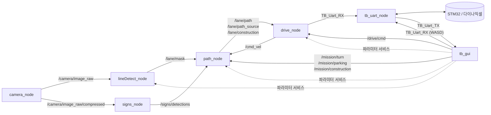

# TurtleBot 자율주행 — 노드 · 토픽 구조

카메라 영상에서 차선을 찾아 경로를 만들고, 그 경로를 따라 모터를 돌리는 ROS 2 워크스페이스입니다.
이 문서는 각 노드가 어떤 토픽을 주고받는지, 그리고 `rqt_graph`만으로는 잘 안 보이는 연결을 정리합니다.

전체 실행:

```bash
ros2 launch tb_line robot.launch.py                  # 전부
ros2 launch tb_line robot.launch.py signs:=false     # YOLO 빼고
ros2 launch tb_line robot.launch.py drive:=false     # 주행 노드 빼고
ros2 launch tb_line robot.launch.py params:=~/tb_params.yaml   # GUI에서 저장한 파라미터로 시작
ros2 run tb_gui tb_gui                               # GUI (별도 실행)
```

---

## 1. 한눈에 보기

주행 파이프라인은 한 줄입니다. 표지판 인식은 옆에서 `path_node`에 정보를 주고, GUI는 전체를 보면서 필요한 곳에 개입합니다.

```
                         ┌────────────── signs_node (YOLO) ──────────────┐
                         │ /camera/image_raw/compressed                   │ /signs/detections
                         │                                                ▼
camera_node ─/camera/image_raw─▶ lineDetect_node ─/lane/mask─▶ path_node ─/lane/path─▶ drive_node ─TB_Uart_RX─▶ tb_uart_node ─▶ STM32 / 모터
                                                                  ▲                          │
                                                                  └──────── /cmd_vel ◀───────┘
                                                         (tb_uart_node의 /odom이 있으면 그걸, 없으면 cmd_vel 적분으로 위치 추정)
```



---

## 2. 패키지와 노드

| 패키지 | 실행 파일 → 노드 이름 | 역할 |
|---|---|---|
| `tb_camera` | `camera_node` → `/camera_node` | USB 카메라 640x480 @ 약 30Hz |
| `tb_line` | `lineDetect_node` → `/lineDetect_node` | HSV 차선 검출, BEV 변환, 라벨 마스크 생성 |
| `tb_signs` | `sign_detect_node` → `/signs_node` | YOLO(TensorRT)로 표지판·벽돌 검출 |
| `tb_path` | `path_node` → `/path_node` | 스켈레톤으로 경로 생성, 벽돌 회피, 공사 구간 판단 |
| `tb_drive` | `drive_node` → `/drive_node` | Pure pursuit + 피봇으로 v, w 계산, 모터 명령 |
| `tb_uart` | `tb_uart_node` → `/tb_uart_node` | 문자열 명령 ↔ STM32 시리얼 |
| `tb_gui` | `tb_gui` → `/tb_gui` | 모니터링, 미션 버튼, 파라미터 조정, WASD |
| `tb_interfaces` | — | 커스텀 메시지 (`LaneMask`, `Detection(Array)`, `DriveCmd`) |

> `tb_signs/src/signs_node.cpp`는 raw 영상을 받는 예전 버전이라 빌드·실행되지 않습니다. launch는 `sign_detect_node`를 `signs_node`라는 이름으로 띄웁니다.

---

## 3. 노드별 입출력

### camera_node
| 방향 | 토픽 | 타입 | 비고 |
|---|---|---|---|
| 발행 | `/camera/image_raw` | `sensor_msgs/Image` | bgr8 |
| 발행 | `/camera/image_raw/compressed` | `sensor_msgs/CompressedImage` | image_transport가 자동 생성 |

### lineDetect_node
| 방향 | 토픽 | 타입 | 비고 |
|---|---|---|---|
| 구독 | `/camera/image_raw` | `Image` | SensorDataQoS |
| 발행 | `/lane/mask` | `tb_interfaces/LaneMask` | **path_node로 가는 유일한 출력** |
| 발행 | `/lane/debug/mask/compressed` | `CompressedImage` | GUI용 |
| 발행 | `/lane/debug/bev/compressed` | `CompressedImage` | GUI용 |
| 발행 | `/lane/debug/roi/compressed` | `CompressedImage` | GUI용 |

### signs_node
| 방향 | 토픽 | 타입 | 비고 |
|---|---|---|---|
| 구독 | `/camera/image_raw/compressed` | `CompressedImage` | depth 1, best effort. 추론이 밀리면 오래된 프레임은 버림 |
| 발행 | `/signs/detections` | `tb_interfaces/DetectionArray` | stamp는 카메라 stamp 그대로 |
| 발행 | `/signs/debug/compressed` | `CompressedImage` | 박스 그린 영상 (GUI용) |

클래스: `barrier_closed`, `barrier_open`, `brick`, `construction`, `left`, `parking`, `right`

### path_node
| 방향 | 토픽 | 타입 | 쓰임 |
|---|---|---|---|
| 구독 | `/lane/mask` | `LaneMask` | 차선 = 벽. 이 콜백 한 번에 경로 하나를 계산 |
| 구독 | `/signs/detections` | `DetectionArray` | `brick` → 벽으로 그림 (표지판 판단은 안 함: tb_brain 담당) |
| 구독 | `/mission/turn` | `std_msgs/UInt8` | 0 직진, 1 좌, 2 우 (갈림길 선택) |
| 구독 | `/mission/parking` | `std_msgs/Bool` | 주차 모드: 노란 점선을 벽에서 뺌 |
| 구독 | `/mission/construction` | `std_msgs/Bool` | true = 공사 구간 진입, false = 끝 (tb_brain 또는 GUI C키) |
| 구독 | `/cmd_vel` | `geometry_msgs/Twist` | `/odom`이 없을 때 적분해서 위치 추정 |
| 구독 | `/odom` | `nav_msgs/Odometry` | tb_uart_node가 발행 (있으면 우선 사용) |
| 발행 | `/lane/path` | `nav_msgs/Path` | `base_link` 기준 (x 앞, y 왼쪽, m) |
| 발행 | `/lane/path_source` | `std_msgs/String` | `live` / `memory` / `color_rule` / `lost` |
| 발행 | `/lane/construction` | `std_msgs/Bool` | 현재 공사 구간 여부 |
| 발행 | `/lane/debug/skel/compressed` | `CompressedImage` | 구독자가 있을 때만 |

### drive_node
| 방향 | 토픽 | 타입 | 쓰임 |
|---|---|---|---|
| 구독 | `/lane/path` | `Path` | 추종할 경로 |
| 구독 | `/lane/path_source` | `String` | `memory`, `color_rule`이면 속도 × `weak_src_pct`(60%) |
| 구독 | `/lane/construction` | `Bool` | 공사 구간 프로필(속도·lookahead·피봇)로 전환 |
| 구독 | `/drive/cmd` | `tb_interfaces/DriveCmd` | FOLLOW / STOP / TWIST |
| 구독 | `/psd/front` | `sensor_msgs/Range` | `drive.psd.enable=false`가 기본, 발행자 없음 |
| 발행 | `/cmd_vel` | `Twist` | 정지 중에도 0을 계속 발행 (path_node가 적분에 사용) |
| 발행 | `TB_Uart_RX` | `String` | `"velocity L R"` (다이나믹셀 원시값). **실제 모터는 이걸로만 움직임** |
| 발행 | `/drive/state` | `String` | 10Hz 상태 문자열 (GUI 표시) |
| 발행 | `/drive/target` | `geometry_msgs/PointStamped` | pure pursuit 목표점. 구독자가 있을 때만 |

### tb_uart_node
| 방향 | 토픽 | 타입 | 내용 |
|---|---|---|---|
| 구독 | `TB_Uart_RX` | `String` | `start`, `quit`, `velocity L R`, `filter`, `direction`, `psd ...`, `get ...` |
| 발행 | `TB_Uart_TX` | `String` | `velocity L R`(`odom.text_period_ms` 간격으로 줄임), `psd F L R`, `stm32 start/quit`, `error ...` |
| 발행 | `/odom` | `nav_msgs/Odometry` | 다이나믹셀 velocity 피드백 적분. 기본 10ms 피드백 → 100Hz |
| 구독 | `/odom/reset` | `std_msgs/Empty` | 위치를 0으로 (보정할 때만, 주행 중엔 X) |

`/dev/ttyUSB*`를 자동으로 찾습니다 (`channel` 파라미터로 고정 가능). 명령은 `start`를 먼저 보내야 받습니다.

odom: STM32가 작동 중인데 velocity 피드백이 안 오면 `velocity period <odom.period_ms>`를 알아서 보냅니다. 다른 노드가 더 느린 주기(예: brain 주차의 33ms)를 요청해도 `odom.period_ms`보다 느려지지 않습니다. 피드백은 모터 방향 그대로 오므로 `direction` 값을 곱해 "전진 = 양수"로 맞춥니다. 바퀴 값(`odom.wheel_radius_m`, `odom.wheel_sep_m`, `odom.pivot_sep_m`, `odom.rpm_per_unit`)은 tb_drive `drive.uart.*`와 같게 둡니다. `log_data:=true`면 velocity·psd packet 로그를 다시 찍습니다 (기본은 안 찍음).

### tb_gui
| 방향 | 토픽 | 쓰임 |
|---|---|---|
| 구독 | `/camera/image_raw/compressed`, `/signs/debug/compressed` | USB 화면 (YOLO 영상이 0.5초 끊기면 원본) |
| 구독 | `/lane/debug/{mask,bev,roi,skel}/compressed` | 차선·경로 디버그 화면 |
| 구독 | `/signs/detections` | 표지판 마지막 검출 시각 표시 (판단에는 안 씀) |
| 구독 | `/lane/path_source`, `/lane/construction`, `/drive/state` | 상태 표시 |
| 구독 | `TB_Uart_TX` | STM32 응답 표시 |
| 발행/구독 | `/mission/turn`, `/mission/parking` | 버튼 → 발행. 같은 토픽을 구독해 버튼 상태를 맞춤 |
| 발행 | `/mission/construction` | C키·체크박스로 진입/끝. 체크 상태는 `/lane/construction`(실제 상태)을 따라감 |
| 발행 | `/drive/cmd` | STOP 버튼 |
| 발행 | `/brain/run` | **Brain 모드**(버튼·Enter)에서 `"start"`(1초마다 다시), 다른 모드로 바꾸면 `"stop"` |
| 발행 | `/mission/pause` | Brain 모드를 끌 때 `false` 한 번 (brain이 걸어둔 정지 풀기) |
| 발행 | `/brain/inject` | "가짜 표지판" 버튼: 표지판 이름(`tl_green`, `left` …). brain이 필터 없이 바로 그 동작 |
| 발행 | `TB_Uart_RX` | WASD 수동 조종, UART 명령 직접 입력 |

---

## 4. 토픽 목록 (발행 → 구독)

| 토픽 | 타입 | 발행 | 구독 |
|---|---|---|---|
| `/camera/image_raw` | `Image` | camera_node | lineDetect_node |
| `/camera/image_raw/compressed` | `CompressedImage` | camera_node | signs_node, tb_gui |
| `/lane/mask` | `LaneMask` | lineDetect_node | path_node |
| `/lane/debug/mask/compressed` | `CompressedImage` | lineDetect_node | tb_gui |
| `/lane/debug/bev/compressed` | `CompressedImage` | lineDetect_node | tb_gui |
| `/lane/debug/roi/compressed` | `CompressedImage` | lineDetect_node | tb_gui |
| `/lane/debug/skel/compressed` | `CompressedImage` | path_node | tb_gui |
| `/signs/detections` | `DetectionArray` | signs_node | path_node, tb_gui |
| `/signs/debug/compressed` | `CompressedImage` | signs_node | tb_gui |
| `/mission/turn` | `UInt8` | tb_gui | path_node, tb_gui |
| `/mission/parking` | `Bool` | tb_gui | path_node, tb_gui |
| `/mission/construction` | `Bool` | tb_brain, tb_gui | path_node |
| `/lane/path` | `Path` | path_node | drive_node |
| `/lane/path_source` | `String` | path_node | drive_node, tb_gui |
| `/lane/construction` | `Bool` | path_node | drive_node, tb_gui |
| `/drive/cmd` | `DriveCmd` | tb_gui | drive_node |
| `/cmd_vel` | `Twist` | drive_node | path_node |
| `/drive/state` | `String` | drive_node | tb_gui |
| `/drive/target` | `PointStamped` | drive_node | (없음) |
| `TB_Uart_RX` | `String` | drive_node, tb_gui | tb_uart_node |
| `TB_Uart_TX` | `String` | tb_uart_node | tb_gui |
| `/odom` | `Odometry` | tb_uart_node | path_node |
| `/psd/front` | `Range` | (없음) | drive_node |

> `TB_Uart_RX`, `TB_Uart_TX`는 앞에 `/`가 없는 상대 이름입니다. 네임스페이스 없이 띄우면 `/TB_Uart_RX`가 됩니다.

---

## 5. 커스텀 메시지 (`tb_interfaces`)

**`LaneMask`** (lineDetect_node → path_node)
- `label`: mono8 BEV 영상. `0` 없음, `1` 흰선, `2` 노란선, `255` 사각지대
- `m_per_px_x`, `m_per_px_y`: 1px당 거리 [m]
- `bottom_offset_m`: 바퀴 축에서 BEV 맨 아랫줄까지 거리
- `lane_w_px`: BEV에서 차선 안쪽 간격
- `homography[9]`: 원본 영상 → BEV 변환. path_node가 YOLO 박스를 BEV로 옮길 때 사용. 값이 바뀌면 path_node가 기억 경로를 초기화합니다.

**`Detection` / `DetectionArray`** (signs_node → path_node, tb_gui)
- `label`, `class_id`, `score`, 박스 `x, y, w, h` (원본 영상 px)
- header stamp = 카메라 stamp. path_node는 마스크 stamp와 비교해 `path.det_max_age_ms`(300ms)보다 오래된 검출은 무시합니다.

**`DriveCmd`** (→ drive_node)
- `mode`: `FOLLOW=0` (경로 추종), `STOP=1`, `TWIST=2` (v, w 직접)
- `speed_limit`: FOLLOW 속도 상한 [m/s]
- `v`, `w`: TWIST 전용
- `drive.cmd_timeout_ms`(500ms) 동안 안 오면 무시. `drive.require_cmd=false`(기본)이면 명령이 없을 때 FOLLOW로 동작합니다.

---

## 6. 주요 흐름

### 차선 주행 (기본)
1. `camera_node`가 영상 발행
2. `lineDetect_node`가 흰선/노란선을 BEV 라벨 영상으로 → `/lane/mask`
3. `path_node`가 차선을 벽으로 보고 스켈레톤(가운데 선)을 따서 경로 생성 → `/lane/path`
   - 차선을 놓치면 지나온 경로(`memory`)나 색 규칙(`color_rule`)으로 채움 → `/lane/path_source`
4. `drive_node`가 30Hz로 경로를 pure pursuit 추종, 급한 코너는 피봇 → `TB_Uart_RX`
5. `tb_uart_node`가 STM32로 전송

### 위치 추정 루프
`drive_node`의 `/cmd_vel` → `path_node`가 적분해 자기 위치 추정 → 기억 경로와 지나간 벽돌 위치 갱신.
`/odom`이 0.5초 안에 들어오면 그쪽을 우선합니다. 기준이 바뀌면 기억 경로는 초기화됩니다.

### 벽돌 · 공사 구간
- `/signs/detections`의 `brick` 박스를 homography로 BEV에 옮겨 **벽으로 그림** → 스켈레톤이 자연스럽게 피해 감
- 공사 구간 진입: **tb_brain**이 `construction` 표지판을 확인하면(`sign.construction.*` 크기·`sign.confirm_frames` 필터) `/mission/construction` true, 또는 GUI C키. path_node는 표지판을 직접 보지 않음
- 공사 구간 끝: `/mission/construction` false(brain은 parking 표지판에서 보냄), GUI X키(`/mission/construction_exit`), 또는 path_node 자동 종료 — 벽돌을 본 뒤 `path.con_exit_mm` 동안 안 보이거나, 벽돌을 한 번도 못 보고 `path.con_no_brick_mm`을 가면
- brain의 `mission.con_end_mode`: 0 = 위 path_node 자동 종료, 1 = 진입 후 `mission.con_hold_ms`, 2 = 주차 표지판까지. 1·2를 쓸 때는 `path.con_exit_mm`, `path.con_no_brick_mm`을 0으로
- `mission.con_once`(기본 1): 한 번 들어간 뒤 주차 표지판을 볼 때까지 공사 표지판 무시 (출구 쪽 표지판으로 재진입 방지)
- 상태는 `/lane/construction`으로 알림 → `drive_node`가 공사 구간 프로필(저속, 긴 lookahead, 피봇 안 함)로 전환

### 미션 (갈림길 · 주차)
- `/mission/turn`, `/mission/parking`은 **현재 GUI 버튼으로만** 바뀝니다.
- `left`, `right`, `parking` 표지판은 GUI에 마지막 검출 시각만 표시되고, 자동으로 미션을 바꾸지 않습니다.

---

## 7. rqt_graph에 안 보이는 연결

- **파라미터 서비스**: tb_gui가 `AsyncParametersClient`로 `/lineDetect_node`, `/path_node`, `/drive_node`의 파라미터를 직접 바꾸고, parameter event로 변경을 받습니다. `drive.enable`(주행 켜기)도 이 방식입니다.
- **발행자 없는 토픽**: `/psd/front` (rqt에서 "Dead sinks" 숨김이 켜져 있으면 안 보임)
- **구독자 있을 때만 발행**: `/drive/target`, `/lane/debug/skel/compressed`

---

## 8. 주의할 점

- **`TB_Uart_RX` 발행자가 둘**: drive_node(자율주행)와 tb_gui(WASD). `drive.enable=false`로 끄면 drive_node가 0을 한 번 보내고 조용해지지만, 켠 상태에서 WASD를 누르면 명령이 섞입니다.
- **GUI 주행 모드 4개**: 정지(`drive.enable` 끔) / WASD / 자동(`enable` + `require_cmd` 끔 → 명령 없어도 FOLLOW) / Brain(`enable` + `require_cmd` 켬 + `/brain/run start` → brain이 `/drive/cmd`를 줘야 움직임). 정지로 두면 drive_node가 꺼져 있어서 brain 명령도 무시됩니다.
- **`drive.enable` 기본값은 false**: launch만 해서는 안 움직이고, GUI에서 켜야 합니다. GUI 파라미터 저장/불러오기에서도 이 값은 빠집니다.
- **표지판 판단은 `tb_brain` 한 곳**: `/signs/detections` → `/mission/turn`, `/mission/construction`, `/mission/pause`, `/drive/cmd`. 박스 크기·점수·연속 프레임 필터(`sign.*`)는 GUI Params 탭 "표지판 검출 필터"에서 조정하고 Save 파일에 `/brain_node` 항목으로 저장됩니다.
